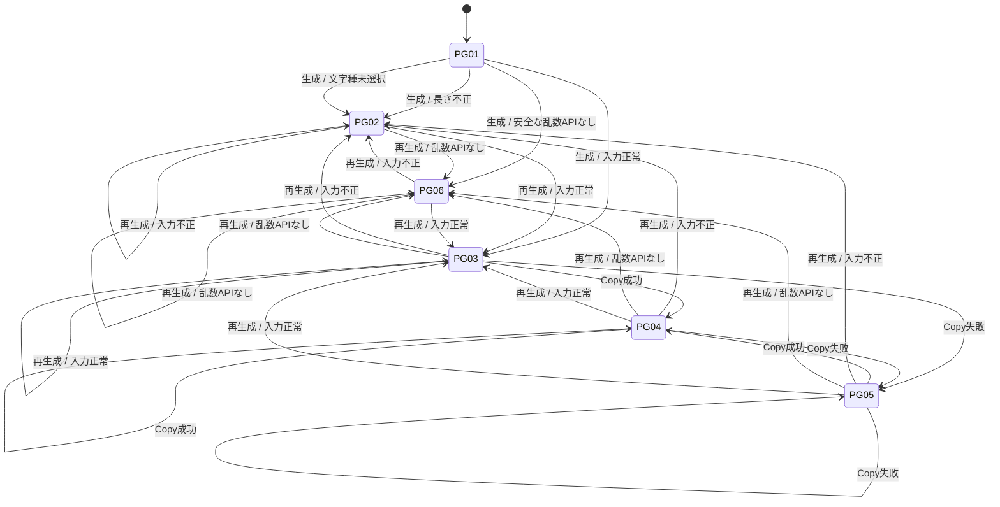

# パスワードジェネレーター 画面遷移図

## 文書情報

| 項目 | 内容 |
|------|------|
| 文書名 | パスワードジェネレーター 画面遷移図 |
| 対象 | `/tools/password-generator/` |
| 作成日 | YYYY-MM-DD |
| 更新日 | YYYY-MM-DD |
| 作成者 | 未記入 |
| 状態 | Draft |
| 関連文書 | [要件定義書](PASSWORD_GENERATOR_REQUIREMENTS.md)、[外部設計書](PASSWORD_GENERATOR_EXTERNAL_DESIGN.md)、[内部設計書](PASSWORD_GENERATOR_INTERNAL_DESIGN.md) |

## 1. 対象画面

本機能は単一ページ内で状態を切り替える。成功・エラー通知は画面遷移ではなく、ページ内のステータス領域に表示する。

| 画面ID | 画面・状態 | 表示内容 |
|--------|------------|----------|
| PG-01 | 初期状態 | 入力フォーム、空の結果欄、無効なCopyボタン |
| PG-02 | 入力エラー | フォームとエラー通知。結果欄は空 |
| PG-03 | 生成済み | 生成値、利用可能なCopyボタン、生成完了通知 |
| PG-04 | コピー済み | 生成値とコピー完了通知 |
| PG-05 | コピー失敗 | 生成値を選択し、手動コピー案内を表示 |
| PG-06 | 乱数機能利用不可 | 結果欄は空、利用不可通知 |

## 2. 状態遷移図

## 3. イベント・遷移仕様

| 現在状態 | イベント／条件 | 次状態 | 結果・操作の扱い |
|----------|----------------|--------|------------------|
| PG-01 | Generate、入力正常 | PG-03 | 結果を表示し、Copyを有効化 |
| PG-01 | Generate、長さ不正または文字種未選択 | PG-02 | 結果を空にし、Copyを無効化して通知 |
| PG-01 | Generate、安全な乱数APIなし | PG-06 | 結果を空にし、Copyを無効化して通知 |
| PG-02～PG-06 | Generate、入力正常 | PG-03 | 新しい結果で置き換え、通知を更新 |
| PG-02～PG-06 | Generate、入力不正 | PG-02 | 既存結果を消去し、Copyを無効化 |
| PG-02～PG-06 | Generate、安全な乱数APIなし | PG-06 | 既存結果を消去し、Copyを無効化 |
| PG-03～PG-05 | Copy成功 | PG-04 | 結果値は保持し、成功を通知 |
| PG-03～PG-05 | Copy失敗 | PG-05 | 結果値を保持・選択し、手動操作を案内 |

## 4. ページ離脱・外部遷移
- ジェネレーターから必須となる外部画面遷移はない。
- ページを再読み込み・離脱した場合、現行実装では生成値は保持しない。
- ブラウザーのクリップボード許可ダイアログが表示される場合がある。これはサイト内画面遷移の対象外。
- その他の遷移: 未記入

## 5. 確認項目
- [ ] 初期状態でCopyが無効である
- [ ] 不正入力後に結果が消去され、Copyが無効になる
- [ ] 生成成功後に結果が表示され、Copyが有効になる
- [ ] Copy成功・失敗の状態通知をそれぞれ確認する
- [ ] 生成を繰り返したとき結果が新しい値に置き換わる
- [ ] ページ再読み込み後に生成値が残らない

## 6. 未決事項・変更履歴

### 6.1 未決事項
- 画面状態やエラー文言を変更した場合は、状態IDと遷移表を更新する。
- 図を追加する場合の表記規約: 未記入

### 6.2 変更履歴
| 日付 | 版 | 変更内容 | 作成者 |
|------|----|----------|--------|
| YYYY-MM-DD | 0.1 | 雛形作成 | 未記入 |