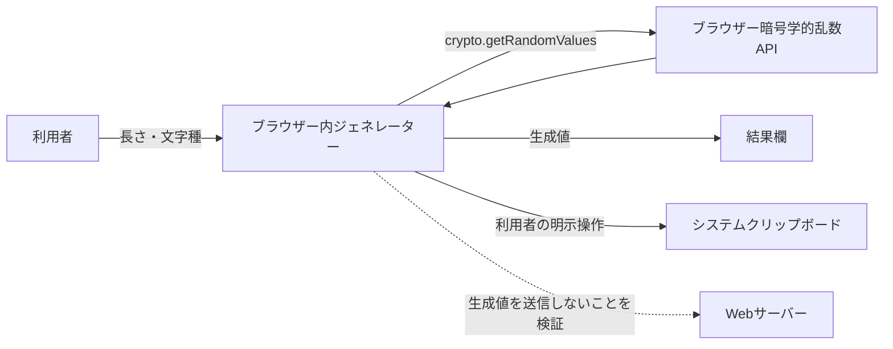

# パスワードジェネレーター セキュリティ／プライバシー確認書

## 文書情報

| 項目 | 内容 |
|------|------|
| 文書名 | パスワードジェネレーター セキュリティ／プライバシー確認書 |
| 対象 | `/tools/password-generator/` および生成値の取扱い |
| 作成日 | YYYY-MM-DD |
| 更新日 | YYYY-MM-DD |
| 確認者 | 未記入 |
| 状態 | Draft |
| 関連文書 | [要件定義書](PASSWORD_GENERATOR_REQUIREMENTS.md)、[外部設計書](PASSWORD_GENERATOR_EXTERNAL_DESIGN.md)、[内部設計書](PASSWORD_GENERATOR_INTERNAL_DESIGN.md)、[テスト仕様書](PASSWORD_GENERATOR_TEST_SPECIFICATION.md) |

## 1. 目的・確認範囲

本書は、パスワード生成、画面表示、クリップボードコピー、およびページで読み込まれるコードが生成値に与えるセキュリティ／プライバシー上の影響を確認し、残留リスクと判断を記録する。

### 1.1 対象ファイル・機能
| 対象 | 内容 | 確認状況 |
|------|------|----------|
| `assets/password-generator.js` | 乱数取得、生成、表示、コピー | 未確認／要記入 |
| `tools/password-generator/index.html` | 入力、結果欄、スクリプト読み込み | 未確認／要記入 |
| `_includes/head.html` および共通アセット | 外部スクリプト、解析・広告などページ共通コード | 未確認／要記入 |
| ホスティング／配信設定 | HTTPS、キャッシュ、ログ、CSP等 | 未確認／要記入 |

## 2. データ分類・データフロー

| データ | 分類 | 発生・保存場所 | 送信先・保持期間 |
|--------|------|----------------|------------------|
| 生成パスワード | 高機密 | ブラウザー内のメモリー、結果欄、利用者のクリップボード | 現行設計ではサーバー送信・永続保存なし。確認が必要 |
| 長さ・文字種選択 | 利用設定 | フォーム入力 | 送信・保存の有無を確認する |
| 利用状況・アクセスログ | 個人データとなる可能性 | Webサイト／外部解析・ホスティング | 対象サービス、項目、保持期間を記入する |

### 2.1 データフロー図

図中の破線はデータ送信を示すものではなく、送信がないことの確認対象を示す。実際の外部通信・第三者コードがあれば、実態に合わせて図を修正する。

## 3. 脅威・プライバシー観点

| ID | 脅威・懸念 | 想定影響 | 確認する対策・証跡 | 判定 |
|----|------------|----------|--------------------|------|
| SP-01 | 弱い乱数や偏りのある選択 | 推測されやすい生成値 | `crypto.getRandomValues` と棄却サンプリングの実装確認 | 未確認 |
| SP-02 | 生成値の意図しない通信・解析送信 | 第三者またはサーバーへの漏えい | Network記録、通信コード、解析・広告タグの確認 | 未確認 |
| SP-03 | 生成値の永続化・ログ出力 | 端末・運用ログからの漏えい | Storage、ログ、エラー報告コードの確認 | 未確認 |
| SP-04 | 同一ページ上の第三者スクリプト | DOM上の生成値へのアクセス可能性 | 読込スクリプト、提供元、権限、必要性の棚卸し | 未確認 |
| SP-05 | XSSまたは改ざんされた依存コード | 生成値の窃取・表示改ざん | DOM出力方法、依存関係、配信・デプロイ経路の確認 | 未確認 |
| SP-06 | クリップボードへの誤コピー・共有端末上の残留 | 他アプリや利用者による閲覧 | 明示操作、コピー通知、利用者向け注意の要否を検討 | 未確認 |
| SP-07 | クリップボードAPI／安全なコンテキストの非対応 | コピー不能または誤った失敗表示 | HTTPS、権限拒否、API非対応時の動作確認 | 未確認 |
| SP-08 | ブラウザーキャッシュ・画面記録・共有 | 端末や周囲からの露出 | キャッシュ、スクリーンショット、表示中の扱いを評価 | 未確認 |
| SP-09 | 生成値を含むテスト証跡・不具合報告 | チケットやログへの漏えい | テスト手順で秘密値を記録しないことを明示 | 未確認 |

## 4. セキュリティ確認チェックリスト

### 4.1 生成・乱数
- [ ] 暗号学的に安全な乱数APIを利用し、利用不可時に安全側へ失敗する
- [ ] 乱数範囲の変換で偏りを避けている
- [ ] 文字種を保証するロジックが要件どおりである
- [ ] 生成値を予測可能なシード、定数、通常の疑似乱数へフォールバックしない

### 4.2 データ取扱い
- [ ] 生成値がHTTPリクエスト、URL、Cookie、解析イベントに含まれない
- [ ] 生成値がLocal/Session Storage、IndexedDB、キャッシュ、ログに保存されない
- [ ] エラー監視、録画、セッションリプレイ等へ生成値が収集されない
- [ ] コピーは利用者の明示操作に限られ、失敗時にも意図しない送信をしない
- [ ] 第三者スクリプトが結果欄へアクセス可能な点を評価し、必要性・対策を記録した

### 4.3 実装・配信
- [ ] 生成値はHTMLとして解釈させず、安全なDOMプロパティで表示する
- [ ] HTTPSで配信し、必要な場合はCSP等のセキュリティヘッダーを設定する
- [ ] 依存ライブラリ、外部スクリプト、デプロイ権限を棚卸しした
- [ ] 共有端末・画面露出・クリップボードに関する残留リスクを評価した

## 5. 既存対策・証跡

| 対策 | 実装箇所／確認方法 | 結果・証跡 | 担当・日付 |
|------|--------------------|------------|------------|
| 安全な乱数 | `assets/password-generator.js` を確認 | 未記入 | 未記入 |
| 生成値を送信しない | Networkパネル、通信実装を確認 | 未記入 | 未記入 |
| 永続保存しない | Storageと保存コードを確認 | 未記入 | 未記入 |
| 外部スクリプトの評価 | ページが読み込む全スクリプトを棚卸し | 未記入 | 未記入 |
| コピー失敗時の安全な扱い | Clipboard拒否状態で動作確認 | 未記入 | 未記入 |

## 6. 残留リスク・判断

| リスクID | 残留リスク | 受容理由・追加対策 | 判断者 | 判断日 |
|----------|------------|--------------------|--------|--------|
| 未記入 | 未記入 | 未記入 | 未記入 | 未記入 |

### 6.1 結論
- [ ] 承認
- [ ] 条件付き承認（条件を記載）
- [ ] 要修正
- [ ] 再確認が必要

結論・条件: 未記入

## 7. 未決事項・変更履歴

### 7.1 未決事項
- 共通ヘッダーで読み込む解析・広告など第三者スクリプトの棚卸し。
- ホスティング側のアクセスログ、キャッシュ、保持期間の確認。
- プライバシー表示や共有端末向け注意の要否。

### 7.2 変更履歴
| 日付 | 版 | 変更内容 | 作成者 |
|------|----|----------|--------|
| YYYY-MM-DD | 0.1 | 雛形作成 | 未記入 |